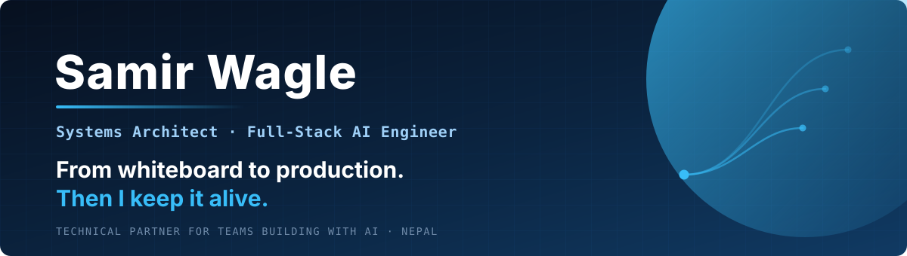
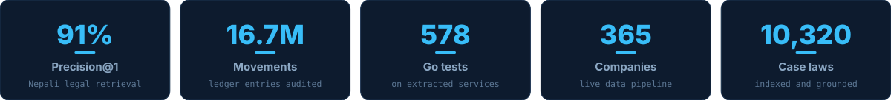
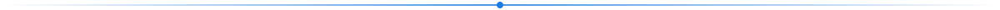
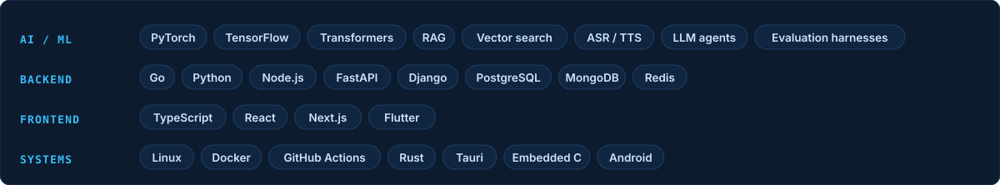

<picture>
  <source media="(prefers-color-scheme: dark)" srcset="assets/hero-dark.svg">
  <source media="(prefers-color-scheme: light)" srcset="assets/hero-light.svg">
  
</picture>

  

  

<picture>
  <source media="(prefers-color-scheme: dark)" srcset="assets/stats-dark.svg">
  <source media="(prefers-color-scheme: light)" srcset="assets/stats-light.svg">
  
</picture>

 

I build practical AI systems that solve real problems — AI integration, backend engineering and automation, turned into reliable production software. Systems that run efficiently, scale sensibly, and produce measurable results.

My work sits where research rigour meets systems ownership: retrieval and grounded generation, agent workflows, speech and low-resource NLP, and the unglamorous backend plumbing that keeps any of it alive once real users arrive.

**Architecture, implementation and the pager after launch — one person, all three.**

<picture><source media="(prefers-color-scheme: dark)" srcset="assets/divider-dark.svg"></picture>

<h2>What I do</h2>

<table>
<tr>
<td width="33%" valign="top">

### ⚙️ Production AI pipelines
Ingestion, model routing, evaluation sets, caching, deployment, monitoring.

**Cost per run is measured, not guessed.**

</td>
<td width="33%" valign="top">

### 🤖 AI systems & automation
Agents, workflows, document intelligence.

**Deterministic code owns contracts and permissions; humans approve expensive actions.**

</td>
<td width="33%" valign="top">

### 📚 RAG & knowledge systems
Corpus ingestion, retrieval baselines, grounded generation.

**Citations that survive all the way to the user.**

</td>
</tr>
<tr>
<td valign="top">

### 🗣️ Language & speech AI
Low-resource NLP, ASR and TTS adaptation, dataset design, multilingual comparison.

**Evaluation limits stated, not hidden.**

</td>
<td valign="top">

### 🏗️ Backend & platform
Go, Python, TypeScript, PostgreSQL, Docker, CI/CD, Linux.

**The layer AI features actually ship on.**

</td>
<td valign="top">

### 🔬 Applied research
Nepali legal QA, multimodal hate detection, sentiment, profanity.

**4 published papers — IEEE, ACL Anthology, LREC workshop.**

</td>
</tr>
</table>

<picture><source media="(prefers-color-scheme: dark)" srcset="assets/divider-dark.svg"></picture>

<h2>Selected work</h2>

<table>
<tr><td width="50%" valign="top">

#### ⚖️ [NepSAUL — Nepali legal QA](https://doi.org/10.1109/ICNLP69856.2026.11528061)

Retrieval plus grounded generation over **10,320 Supreme Court case laws**. Lexical against multilingual dense retrieval, measured end to end.

`91% Precision@1` `85% truthfulness`
🏆 National hackathon winner · IEEE ICNLP 2026

</td><td width="50%" valign="top">

#### 🏦 Platform architecture modernization

*Production fintech — details sanitized.* Legacy Python capabilities migrated to tested Go services **without breaking existing contracts**. Mobile, web, backend, database, deploy.

`16.7M ledger movements audited` `3 integrity tests` `578 Go tests`

</td></tr>
<tr><td valign="top">

#### 📈 [NEPSE market data pipeline](https://github.com/SamirWagle/Nepse-All-Scraper)

Prices, dividends, right shares and daily floorsheets collected on a schedule and published as versioned open data.

`365 listed companies` · [open data API →](https://samirwagle.github.io/Nepse-All-Scraper/)

</td><td valign="top">

#### 🗣️ [Chatterbox Nepali — speech adaptation](https://huggingface.co/waglesameer5/chatterbox-nepali)

500M multilingual speech model adapted for Nepali: Devanagari handling, alignment analysis, Apple Silicon training path. Public weights.

[model card](https://huggingface.co/waglesameer5/chatterbox-nepali) · [source](https://github.com/SamirWagle/chatterbox-nepali)

</td></tr>
<tr><td valign="top">

#### 🖼️ [MEME-Fusion — cross-modal Devanagari](https://arxiv.org/abs/2604.14218)

CLIP and BGE-M3 joined through cross-modal attention and a learned gate; eight configurations ablated.

`+5.9 F1-macro over text-only` · CHiPSAL @ LREC 2026

</td><td valign="top">

#### 🪪 Document intelligence for identity onboarding

*Merged, regulated workflow.* Multimodal extraction with prompt design, canonical field mapping, date normalization and **deterministic code validation**.

</td></tr>
<tr><td valign="top">

#### 📝 [NECPrep](https://lisensepreparation.samirwagle.com.np/)

Open-source NEC licence exam prep — mock tests, flashcards, local progress.

`1,380+ questions` `TypeScript / React`

</td><td valign="top">

#### 🛡️ [Privacy Aperture](https://github.com/SamirWagle/LaptopPrivacy)

Native macOS privacy controls in Rust and Tauri, shipped with a tested-versus-planned capability matrix.

`Rust` `Tauri`

</td></tr>
</table>

<a href="https://www.samirwagle.com.np/work.html"><b>Full portfolio and case studies →</b></a>

<picture><source media="(prefers-color-scheme: dark)" srcset="assets/divider-dark.svg"></picture>

<h2>Research</h2>

| Paper | Venue | Year |
|:--|:--|:--:|
| [MEME-Fusion: Multimodal Ablation Study of Hate Detection and Sentiment Analysis on Nepali Memes](https://arxiv.org/abs/2604.14218) | CHiPSAL @ LREC | 2026 |
| [Retrieval Augmented Generation Framework for the Nepali Legal Domain Question Answering](https://doi.org/10.1109/ICNLP69856.2026.11528061) | IEEE ICNLP | 2026 |
| [Evaluating Sentence Embedding Models for Nepali Sentiment Analysis](https://ncci.ku.edu.np/uploads/archive/1770519872205-KUSET_Evaluating_Sentence_Embedding_Models_for_Nepali_Sentiment_Analysis__A_Comparative_Study-Adam-First-man.pdf) | KUSET 18(2) | 2024 |
| [Profanity and Offensiveness Detection in Nepali Using Bi-Directional LSTM](https://aclanthology.org/2024.icon-1.60/) | ICON — 21st Intl. Conf. on NLP | 2024 |

<picture><source media="(prefers-color-scheme: dark)" srcset="assets/divider-dark.svg"></picture>

<h2>Stack</h2>

<picture>
  <source media="(prefers-color-scheme: dark)" srcset="assets/stack-dark.svg">
  <source media="(prefers-color-scheme: light)" srcset="assets/stack-light.svg">
  
</picture>

<picture><source media="(prefers-color-scheme: dark)" srcset="assets/divider-dark.svg"></picture>

<h2>How I work with teams</h2>

| | Phase | What you get |
|:--:|:--|:--|
| **1** | **Audit** — 1–2 weeks, fixed scope | Opportunity map, cost analysis, system design, delivery plan |
| **2** | **Build** — multi-week engineering | Implementation across AI, application, integration and infrastructure |
| **3** | **Handover** | Documentation, team training, cost exposure, explicit support boundaries |

Bring me the place where **work, cost, or reliability** is breaking down.

  

  

<a href="https://www.samirwagle.com.np">Website</a> ·
<a href="https://github.com/SamirWagle?tab=repositories">Repositories</a> ·
<a href="https://www.linkedin.com/in/samir-wagle-349591142">LinkedIn</a> ·
<a href="https://huggingface.co/waglesameer5">Hugging Face</a> ·
<a href="https://www.kaggle.com/sameerwagle">Kaggle</a> ·
<a href="mailto:waglesameer5@gmail.com">waglesameer5@gmail.com</a>

